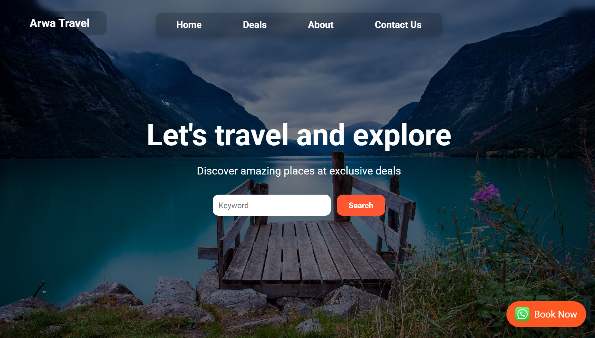
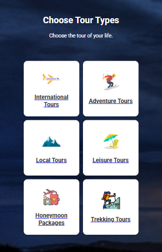

# Arwa Travels — Tour Package Booking & Travel Discovery Platform

[](https://www.php.net/)
[](https://www.mysql.com/)
[](https://developer.mozilla.org/en-US/docs/Web/JavaScript)
[](https://developer.mozilla.org/en-US/docs/Web/CSS)
[](https://wa.me/923335511100)
[](LICENSE)

Official web platform for **Arwa Travels**, a tourism, holiday package, and tour operations agency. The platform features categorical travel exploration, interactive package deal showcases, multi-currency pricing, detailed itinerary breakdowns (accommodation, meals, required documents), direct WhatsApp reservation routing, and an administrative CMS for package publishing.

---

## 📑 Table of Contents

- [Visual Showcase & Screenshots](#-visual-showcase--screenshots)
- [Overview & Architecture](#-overview--architecture)
- [Key Features](#-key-features)
- [Technology Stack](#-technology-stack)
- [Project Directory Structure](#-project-directory-structure)
- [Database Schema & Structure](#-database-schema--structure)
- [Local Development Setup](#-local-development-setup)
- [Administrative CMS Portal](#-administrative-cms-portal)
- [👥 Contributors](#-contributors)
- [📞 Contact & Booking Channels](#-contact--booking-channels)
- [📄 License](#-license)

## 📸 Visual Showcase & Screenshots

<div align="center">

### Homepage & Destination Search Experience


### Tour Package Deals & Categorical Catalog


</div>

---

## 🌟 Overview & Architecture

Arwa Travels provides a customer-centric travel booking experience integrated with a streamlined administrative backend:

1. **Customer Discovery & Booking**:
   - **Categorical Navigation**: Segmented browsing across International tours, Adventure trips, Local tourism, Leisure holidays, Honeymoon getaways, and Mountain trekking expeditions.
   - **Interactive Deals Carousel**: Client-side touch-enabled card carousel (`home.js`) presenting highlighted destinations with currency-specific pricing.
   - **Comprehensive Package Dossiers**: Dynamic single-tour view (`tour-details.php`) providing trip duration, accommodation standards, meal inclusions, visa/document checklists, and multi-image galleries.
   - **1-Click WhatsApp Reservation Gateway**: Direct conversion funnel connecting travelers to travel coordinators via WhatsApp with pre-filled package context.

2. **Internal Content Management (CMS)**:
   - **Detail Publishing Portal** (`i-the-detail-portal.php`): Form interface for travel staff to publish new tour offerings, upload multi-angle destination photographs (`uploads/`), set global currencies, and link multiple categories per tour.
   - **Relational Categorization**: Many-to-many relationship mapping between tours and tour types using composite foreign keys.

---

## 🚀 Key Features

- **Categorical Tour Discovery**:
  - ✈️ **International Tours**: Global destinations and holiday itineraries.
  - ⛷️ **Adventure Tours**: Action-packed activities and winter excursions.
  - 🏔️ **Local Tours**: Domestic heritage sites and northern valleys.
  - 🏖️ **Leisure Tours**: Relaxing beachfront escapes and family resorts.
  - 💍 **Honeymoon Packages**: Romantic suites and tailored couples' packages.
  - 🥾 **Trekking Tours**: High-altitude expeditions and hiking trails.
- **Multi-Currency Pricing Matrix**: Built-in support for global currencies (`PKR`, `USD`, `EUR`, `GBP`, `AUD`, `CAD`).
- **Dynamic Category Filtering**: Server-side query parameter filtering (`view-all-deals.php?type=1`) returning category-specific search results.
- **Floating Quick-Booking CTA**: Mobile-friendly persistent WhatsApp booking button with direct chat initiation (`+92 333 55 111 00`).
- **Clean Responsive Layout**: Tailored mobile drawer navigation, responsive grid layouts, and typography optimized for mobile devices and desktops.

---

## 🛠️ Technology Stack

| Layer | Technologies | Details |
|---|---|---|
| **Frontend** | HTML5, CSS3, Vanilla JavaScript (ES6+) | Lightweight, fast-loading responsive user interface |
| **Typography & Icons** | Google Fonts (Roboto), Custom PNG Iconography | Clean travel iconography located in `Photos/` |
| **Backend** | PHP 7.4+ / PHP 8.x (MySQLi Extension) | Dynamic server-side rendering and multipart image upload processing |
| **Database** | MySQL 5.7+ / MariaDB (InnoDB) | Relational schema with foreign keys, cascade deletes, and composite indices |
| **Integrations** | WhatsApp Click-to-Chat API | Direct customer booking and inquiry pipeline |

---

## 📁 Project Directory Structure

```text
Arwa_Travels_Website/
├── About us/                           # Corporate & company overview
│   ├── aboutus.css                     # About page styles
│   ├── aboutus.html                    # Mission, vision, and agency profile
│   └── aboutus.js                      # Mobile drawer toggle script
├── ARWA TRAVEL/                        # Database installation files
│   └── sql.txt                         # Full MySQL database schema & seed queries
├── Home/                               # Internal scripts
│   └── test_image_path.php             # Image path diagnostic utility
├── Photos/                             # Travel icons, banners, and logos
│   ├── airplane.png                    # International tour icon
│   ├── skiing.png                      # Adventure tour icon
│   ├── mountain.png                    # Local tour icon
│   ├── beach-chair (1).png             # Leisure tour icon
│   ├── honeymoon.png                   # Honeymoon package icon
│   ├── hiking.png                      # Trekking tour icon
│   ├── booknow-icon.png                # WhatsApp floating button icon
│   └── menu (1).png                    # Mobile hamburger icon
├── includes/                           # Server includes
│   └── db.php.example                  # Sample MySQLi database connection script
├── screenshots/                        # Project showcase screenshots
├── uploads/                            # Destination images uploaded via CMS
├── .env.example                        # Environment variables template
├── home.css                            # Main landing page stylesheet
├── home.js                             # Top deals carousel & navigation drawer
├── i-the-detail-portal.css             # CMS tour creation styling
├── i-the-detail-portal.php             # Admin package creation & image uploader
├── index.php                           # Homepage with hero search, categories & carousel
├── tour-details.css                    # Single tour showcase styling
├── tour-details.js                     # Tour details page interactivity
├── tour-details.php                    # Dynamic package view (amenities, meals, documents)
├── view-all-deals.css                  # Deals catalog layout & cards
├── view-all-deals.js                   # Deals catalog filtering scripts
├── view-all-deals.php                  # Filterable tour package catalog
├── CONTRIBUTING.md                     # Contribution guidelines
├── LICENSE                             # License terms
└── README.md                           # Project documentation
```

---

## 💾 Database Schema & Structure

The platform runs on MySQL using the schema defined in [`ARWA TRAVEL/sql.txt`](ARWA%20TRAVEL/sql.txt):

### 1. `tours` Table
Core package records:
- `tour_id`: Primary Key (AUTO_INCREMENT).
- `tour_name`: Descriptive title of the tour package.
- `accommodation`: Hotel/resort tier details (e.g. 4-star, deluxe suite).
- `required_documents`: Passport, visa, and health requirements.
- `main_image`, `image2`, `image3`: Relative paths to destination photographs.
- `price`: Numeric decimal value.
- `duration`: Duration descriptor (e.g. `5 Days / 4 Nights`).
- `meals_provided`: Meal plan inclusions (Breakfast, Half Board, All-Inclusive).
- `currency_code`: Currency symbol/code (`PKR`, `USD`, etc.).

### 2. `tour_types` Table
Lookup table for categorical travel classifications:
- Predefined types: *International Tours*, *Adventure Tours*, *Local Tours*, *Leisure Tours*, *Honeymoon Packages*, *Trekking Tours*.

### 3. `tour_type_relations` Table
Composite join table (`tour_id`, `type_id`) linking tours to one or more categories with `ON DELETE CASCADE`.

### 4. `currencies` Table
Supported billing currencies (`USD`, `EUR`, `GBP`, `PKR`, `AUD`, `CAD`).

### 5. `admin_users` Table
Administrative credentials with encrypted password hashes for CMS access.

---

## 💻 Local Development Setup

### Option 1: Quick Static Preview
You can view the customer-facing pages and design assets immediately using Node:

```bash
# Clone the repository
git clone https://github.com/crater-code/Arwa_Travels_Website.git
cd Arwa_Travels_Website

# Launch static server on port 3006
npx serve . -l 3006
```
Open **`http://localhost:3006/About%20us/aboutus.html`** in your browser.

---

### Option 2: Full Stack Local Setup (PHP + MySQL)

1. **Prerequisites**:
   - Web server with PHP 7.4+ or 8.x (Apache / XAMPP / Laragon).
   - MySQL 5.7+ or MariaDB.

2. **Database Initialization**:
   - Create the database and import [`ARWA TRAVEL/sql.txt`](ARWA%20TRAVEL/sql.txt):
     ```bash
     mysql -u root -p -e "CREATE DATABASE arwa_travels;"
     mysql -u root -p arwa_travels < "ARWA TRAVEL/sql.txt"
     ```

3. **Configure Database Connection**:
   - Copy `includes/db.php.example` to `includes/db.php`:
     ```bash
     cp includes/db.php.example includes/db.php
     ```
   - Adjust credentials to match your local MySQL configuration:
     ```php
     $servername = "localhost";
     $username   = "root";
     $password   = "";
     $dbname     = "arwa_travels";

     $conn = new mysqli($servername, $username, $password, $dbname);
     ```

4. **Launch Application**:
   - Using PHP built-in server:
     ```bash
     php -S localhost:8000
     ```
   - Open **`http://localhost:8000`** in your browser.

---

## 🔐 Administrative CMS Portal

Travel operators can manage the catalog through the package publisher:
- **URL**: `http://localhost:8000/i-the-detail-portal.php`
- **Capabilities**:
  - Add new tour titles and duration descriptors.
  - Set package price with currency selector.
  - Upload 3 high-resolution destination photographs into `uploads/`.
  - Check off multiple tour type categories (e.g. Adventure + International).
  - Define document prerequisites and meal arrangements.

---

## 👥 Contributors

- **Muhammad Ali**: [LinkedIn Profile](https://www.linkedin.com/in/muhammad-ali-23828a2b0/)
- **Muhammad Shaheer Tariq**: [LinkedIn Profile](https://www.linkedin.com/in/shaheer-tariq-93285b311/)

---

## 📞 Contact & Booking Channels

- **Agency**: Arwa Travels
- **Phone**: [+92 333 55 111 00](tel:+923335511100)
- **Email**: [arwatravels@gmail.com](mailto:arwatravels@gmail.com)
- **WhatsApp**: [Direct Booking Chat](https://wa.me/923335511100)

---

## 📄 License

This project is licensed under the MIT License — see the [LICENSE](LICENSE) file for details.
